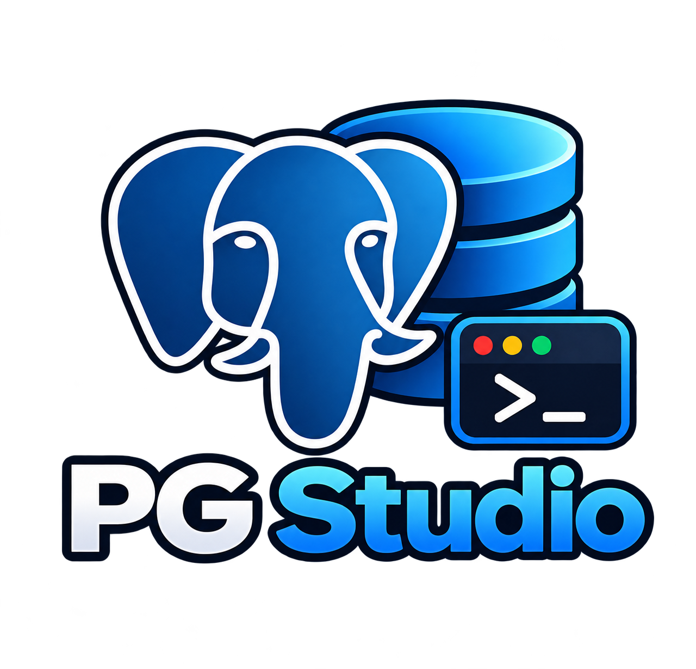

<div align="center">



# PG Studio

**A fast, lightweight desktop client for PostgreSQL.**
Write SQL, browse tables, filter results, export millions of rows, and reach private databases through SSH, all in a small native app.

[](https://github.com/rodrigopacheco100/pg-studio/releases/latest)


[Download](https://github.com/rodrigopacheco100/pg-studio/releases/latest) · [Changelog](CHANGELOG.md) · [Architecture](AGENTS.md)

</div>

---

## Why PG Studio

- **Small and native.** Tauri + Rust instead of a bundled browser; it starts fast and stays light.
- **Safe by default.** Passwords go to the OS credential store (or an encrypted vault), destructive statements ask for confirmation, and SSH host keys are verified.
- **Picks up where you left off.** Tabs, unsaved text and the active connection come back on the next start.
- **Updates itself.** Signed updates install from inside the app, with the release notes shown first.

## Features

### SQL editor
- CodeMirror editor with autocomplete for tables (with automatic aliases), columns and keywords
- Snippets (`sel`, `ins`, `upd`, `del`, `crt`, `idx`, `cte`, `cnt`); `Tab` walks through the fields
- Run the selection or everything (`Ctrl+Enter`), the statement at the cursor (`Ctrl+Shift+Enter`), or click the ▶ beside any statement
- **Stop** button to cancel a running query
- Confirmation before `DROP`, `TRUNCATE`, `ALTER ... DROP` and `DELETE` / `UPDATE` without `WHERE`, including inside CTEs
- Beautify (`Ctrl+Shift+F`), undoable
- Multiple tabs backed by `.sql` files: new, open, save, save as (`Ctrl+T`, `Ctrl+O`, `Ctrl+S`, `Ctrl+Shift+S`, `Ctrl+W`), with an unsaved marker
- Query history and named saved queries

### Results grid
- Sort by any column and filter with column, operator and value (`name starts with al`, `id ≥ 10`), with operators that follow the column type
- Typed values (booleans, numbers, dates, JSON), cell selection, and copy as JSON, CSV, TSV or INSERT
- Large tables are paginated by the server, with sorting and filtering done in SQL

### Exports
- Export **all** rows, not just the visible page, as CSV, JSON or SQL INSERT
- Runs in the background with progress windows, cancel, and a history of past exports

### Browsing the database
- Table tree with lazy folders for columns, constraints, foreign keys, indexes and permissions
- Double-click any item for its full details
- Open a table to browse its data

### Connections
- Folders, drag and drop ordering, duplication, and environment tags (dev, staging, prod)
- SSL, and **SSH tunnels** with private key (and passphrase), password or ssh-agent, using trust-on-first-use host keys
- Automatic reconnection when the connection drops
- Passwords stored in the OS keychain; where there is none (for example WSL), an encrypted vault protected by a master password (Argon2id + ChaCha20-Poly1305) with optional auto-lock

### Personalization
- Themes: Dark, Light, Dracula and Omni built in, follow the system, or import your own as JSON
- Interface and editor fonts, sizes, tab width, keyword case, page size and statement timeout
- Resizable sidebar and editor, remembered between sessions

## Install

Download the installer for your system from the [latest release](https://github.com/rodrigopacheco100/pg-studio/releases/latest) (Windows, macOS on Apple Silicon and Intel, Linux). Later versions are offered inside the app.

## Build from source

Requirements:

- [Bun](https://bun.sh)
- [Rust](https://rustup.rs) (stable toolchain)
- [Tauri 2 system dependencies](https://tauri.app/start/prerequisites/) for your operating system

```sh
bun install
bun run tauri dev     # full app (Tauri + Vite)
bun run dev           # frontend only, at http://localhost:1420
bun run test          # unit tests for the utilities in src/lib
bun run e2e           # end-to-end tests in Docker (Playwright + a real PostgreSQL)
bun run build         # type check + frontend build
bun run tauri build   # produces the installer
```

## Local data

Stored in the app data directory of your operating system:

| File | Contents |
|---|---|
| `pg-studio.sqlite` | connections (without passwords), folders, history, saved queries and the export history |
| `settings.json` | program settings |
| `session.json` | open editor tabs (including unsaved text) and the active connection |
| `vault.json` | encrypted passwords, only where the OS has no credential store |
| `known_hosts.json` | trusted SSH host keys |
| `styles/` | imported themes |

## Project layout

- `src/`: React frontend (components, views, hooks, utilities)
- `src-tauri/`: Rust backend (Tauri commands, PostgreSQL access, SSH tunnel, local storage)
- `e2e/`: Playwright flows against the real app in Docker

See [AGENTS.md](AGENTS.md) for architecture details and conventions.
